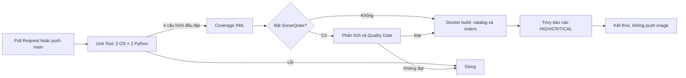

# Demo giảng dạy: CI cho hai Python Microservices

Dự án này là một **kho GitHub độc lập**. Hãy đưa toàn bộ nội dung thư mục `1/` lên **gốc** một repository mới để GitHub nhận file `.github/workflows/ci.yml`. Hai service mẫu là `catalog` (tra cứu sản phẩm) và `orders` (tính tổng đơn hàng). Chúng dùng Python standard library, nên người học có thể tập trung vào CI.

## 1. Sơ đồ luồng



**CI (Continuous Integration)** là việc thường xuyên ghép thay đổi mã vào một nhánh chung và tự động kiểm tra mỗi thay đổi. Thành phần cốt lõi ở đây gồm: sự kiện kích hoạt, runner, các job/step, kiểm thử, báo cáo coverage, kiểm tra chất lượng, build, quét bảo mật và trạng thái đạt/trượt. Trạng thái CI có thể được dùng làm required check trong branch protection.

## 2. Đọc file YAML

| Từ khóa | Ý nghĩa trong demo |
|---|---|
| `name` | Tên workflow, job hoặc step hiện trong giao diện Actions. |
| `on` | Sự kiện `pull_request` và `push` vào `main`. |
| `jobs` | Các chặng `unit-test`, `quality-check`, `image`. |
| `needs` | Quan hệ phụ thuộc; job sau bị chặn nếu job trước trượt. |
| `runs-on` | Máy ảo runner Ubuntu hoặc Windows. |
| `steps` | Những thao tác theo thứ tự trong một job. |
| `uses` | Gọi một action có sẵn, ví dụ checkout, setup Python, Trivy. |
| `with` | Truyền tham số vào action, ví dụ phiên bản Python. |
| `strategy.matrix` | Tạo bốn biến thể `2 OS × 2 Python` chạy song song. |
| `if` | Chỉ upload coverage từ một cấu hình; chỉ chạy SonarQube khi `ENABLE_SONAR=true`. |

Workflow: [.github/workflows/ci.yml](.github/workflows/ci.yml). Trigger PR hoặc push `main` chạy kiểm thử, tạo coverage, tùy chọn phân tích SonarQube, build hai image và quét Trivy. Pipeline kết thúc sau bước quét và không đẩy image lên registry.

### Bộ đệm phụ thuộc

Step `actions/setup-python` với `cache: pip` giữ lại **gói đã tải** theo `requirements-dev.txt`; lần sau vẫn cài theo danh sách phụ thuộc nhưng tránh tải lại. Cache giúp tăng tốc, không phải nơi lưu secret hay bằng chứng kiểm thử. Với Node.js, dùng `actions/setup-node` cùng `cache: npm` và `package-lock.json` thay vì cache trực tiếp `node_modules` dễ bị lệch môi trường. Với Terraform, có thể dùng `actions/cache` cho `~/.terraform.d/plugin-cache`, khóa theo OS và `hashFiles('**/.terraform.lock.hcl')`; đặt `TF_PLUGIN_CACHE_DIR` và tạo thư mục trước `terraform init`. Demo hiện dùng Python nên chỉ bật pip cache trong workflow chạy thật.

## 3. Chạy tại máy của giảng viên

Từ thư mục `1/`:

```powershell
python -m pip install -r requirements-dev.txt
python -m coverage run --source=services -m unittest discover -s tests -v
python -m coverage xml -o coverage.xml
python -m coverage report
docker build -f services/catalog/Dockerfile -t ci-demo-catalog:local .
docker build -f services/orders/Dockerfile -t ci-demo-orders:local .
```

Kết quả kiểm tra trên máy soạn demo: **15 bài test đạt, coverage tổng 95%**. Trên máy người học, con số có thể đổi nếu họ sửa mã hoặc bài test.

Có thể mở API mẫu:

```powershell
python -m services.catalog.app
# GET http://localhost:8080/health
# GET http://localhost:8080/products/book
```

Ở terminal khác có thể chạy `python -m services.orders.app`; đổi cổng `8080` trong file tạm thời nếu chạy hai service cùng lúc. `POST /total` nhận JSON `{"unit_price":25,"quantity":2}` và trả `{"total":50}`.

## 4. Chế độ demo rút gọn

Không cần tạo AWS, ECR hoặc registry. Chỉ cần đẩy repository lên GitHub; workflow tự chạy Unit Test, Coverage, Docker Build và Trivy. SonarQube mặc định được bỏ qua nên thiếu `SONAR_TOKEN` không còn làm pipeline thất bại.

Nếu muốn bật SonarQube sau này, vào **Settings → Secrets and variables → Actions** và thêm:

- Variable `ENABLE_SONAR` có giá trị `true`.
- Secret `SONAR_TOKEN`.
- Variables `SONAR_HOST_URL` và `SONAR_PROJECT_KEY`.

Trivy hiện chạy ở chế độ báo cáo với `exit-code: '0'`: các lỗ hổng HIGH/CRITICAL vẫn xuất hiện trong log nhưng chưa làm pipeline thất bại. Đổi thành `exit-code: '1'` khi muốn dùng Trivy làm cổng chặn bảo mật.

## 5. Kịch bản trình diễn trên lớp

1. Push lên `main` và xem bốn ô Unit Test chạy song song trên hai hệ điều hành và hai phiên bản Python.
2. Mở job `Coverage and optional SonarQube`: báo cáo coverage được tải xuống và SonarQube được ghi nhận là đang tắt.
3. Mở hai job `Docker build and Trivy`: mỗi service được build thành một image và quét HIGH/CRITICAL.
4. Có thể tạm đổi `return unit_price * quantity` thành phép cộng rồi push: Unit Test đỏ và các job phía sau bị bỏ qua. Sau khi trình diễn, khôi phục phép nhân.

Image build từ `python:3.12-slim` có thể xuất hiện CVE mới theo thời gian. Ở chế độ hiện tại, Trivy báo cáo chúng trong log để phục vụ việc học.

## Nguồn chính thức

- [GitHub Actions workflow syntax](https://docs.github.com/en/actions/reference/workflows-and-actions/workflow-syntax)
- [GitHub dependency caching](https://docs.github.com/en/actions/reference/workflows-and-actions/dependency-caching)
- [SonarQube Quality Gate trong GitHub Actions](https://docs.sonarsource.com/sonarqube-server/2025.6/devops-platform-integration/github-integration/adding-analysis-to-github-actions-workflow)
- [Trivy Action](https://github.com/aquasecurity/trivy-action)
