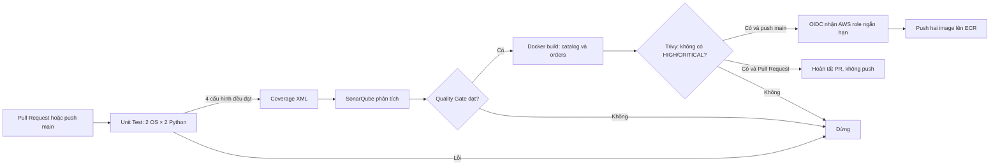

# Demo giảng dạy: CI cho hai Python Microservices

Dự án này là một **kho GitHub độc lập**. Hãy đưa toàn bộ nội dung thư mục `1/` lên **gốc** một repository mới để GitHub nhận file `.github/workflows/ci.yml`. Hai service mẫu là `catalog` (tra cứu sản phẩm) và `orders` (tính tổng đơn hàng). Chúng dùng Python standard library, nên người học có thể tập trung vào CI.

## 1. Sơ đồ luồng



**CI (Continuous Integration)** là việc thường xuyên ghép thay đổi mã vào một nhánh chung và tự động kiểm tra mỗi thay đổi. Thành phần cốt lõi ở đây gồm: sự kiện kích hoạt, runner, các job/step, kiểm thử, báo cáo coverage, kiểm tra chất lượng, build, quét bảo mật và trạng thái đạt/trượt. Trạng thái CI có thể được dùng làm required check trong branch protection.

## 2. Đọc file YAML

| Từ khóa | Ý nghĩa trong demo |
|---|---|
| `name` | Tên workflow, job hoặc step hiện trong giao diện Actions. |
| `on` | Sự kiện `pull_request` và `push` vào `main`. |
| `jobs` | Các chặng `unit-test`, `sonarqube`, `image`. |
| `needs` | Quan hệ phụ thuộc; job sau bị chặn nếu job trước trượt. |
| `runs-on` | Máy ảo runner Ubuntu hoặc Windows. |
| `steps` | Những thao tác theo thứ tự trong một job. |
| `uses` | Gọi một action có sẵn, ví dụ checkout, setup Python, Trivy. |
| `with` | Truyền tham số vào action, ví dụ phiên bản Python. |
| `strategy.matrix` | Tạo bốn biến thể `2 OS × 2 Python` chạy song song. |
| `if` | Chỉ upload coverage từ một cấu hình; chỉ xác thực AWS/push ECR trên push `main`. |

Workflow: [.github/workflows/ci.yml](.github/workflows/ci.yml). Trigger PR chạy kiểm thử, SonarQube, build và Trivy để cho người duyệt thấy lỗi sớm. Push vào `main` chạy lại toàn bộ rồi mới được đẩy image. Không dùng `pull_request_target` để thực thi mã chưa tin cậy với secrets.

### Bộ đệm phụ thuộc

Step `actions/setup-python` với `cache: pip` giữ lại **gói đã tải** theo `requirements-dev.txt`; lần sau vẫn cài theo danh sách phụ thuộc nhưng tránh tải lại. Cache giúp tăng tốc, không phải nơi lưu secret hay bằng chứng kiểm thử. Với Node.js, dùng `actions/setup-node` cùng `cache: npm` và `package-lock.json` thay vì cache trực tiếp `node_modules` dễ bị lệch môi trường. Với Terraform, có thể dùng `actions/cache` cho `~/.terraform.d/plugin-cache`, khóa theo OS và `hashFiles('**/.terraform.lock.hcl')`; đặt `TF_PLUGIN_CACHE_DIR` và tạo thư mục trước `terraform init`. Demo hiện dùng Python nên chỉ bật pip cache trong workflow chạy thật.

## 3. Chạy tại máy của giảng viên

Từ thư mục `1/`:

```powershell
python -m pip install -r requirements-dev.txt
python -m coverage run --source=services -m unittest discover -s tests -v
python -m coverage xml -o coverage.xml
python -m coverage report
docker build -f services/catalog/Dockerfile -t ci-demo-catalog:local .
docker build -f services/orders/Dockerfile -t ci-demo-orders:local .
```

Kết quả kiểm tra trên máy soạn demo: **15 bài test đạt, coverage tổng 95%**. Trên máy người học, con số có thể đổi nếu họ sửa mã hoặc bài test.

Có thể mở API mẫu:

```powershell
python -m services.catalog.app
# GET http://localhost:8080/health
# GET http://localhost:8080/products/book
```

Ở terminal khác có thể chạy `python -m services.orders.app`; đổi cổng `8080` trong file tạm thời nếu chạy hai service cùng lúc. `POST /total` nhận JSON `{"unit_price":25,"quantity":2}` và trả `{"total":50}`.

## 4. Thiết lập GitHub, SonarQube, AWS

1. Tạo repository GitHub mới, đưa **nội dung** `1/` lên root, nhánh chính tên `main`. Giữ `sonar-project.properties` và `.github/workflows/ci.yml` ở root.
2. Tạo một project SonarQube Server **Developer Edition trở lên** với project key riêng. SonarQube Server chỉ hỗ trợ phân tích Pull Request từ Developer Edition; Community Edition không chạy trọn demo PR này. Server phải truy cập được từ GitHub-hosted runner (hoặc dùng runner tự quản lý). Tạo analysis token.
3. Trong GitHub repository **Settings → Secrets and variables → Actions**, thêm secret `SONAR_TOKEN`; thêm variables `SONAR_HOST_URL` (ví dụ `https://sonar.example.com`), `SONAR_PROJECT_KEY`, `AWS_REGION`, `AWS_ROLE_ARN`. Token Sonar là secret vì nó nhạy cảm; host URL, project key, region và role ARN là cấu hình không nhạy cảm.
4. Tạo Quality Gate trong SonarQube. Ví dụ đặt **Coverage on New Code ≥ 80%**, không có blocker/critical issues mới. Gán gate đó cho project. File `coverage.xml` được import vào SonarQube; coverage là dữ liệu đầu vào, còn ngưỡng đạt/trượt do SonarQube quyết định. Đối với bài giảng đầu tiên, kiểm tra định nghĩa New Code và khả năng quét Pull Request của phiên bản SonarQube đang dùng.
5. Trong AWS IAM, thêm OIDC provider `token.actions.githubusercontent.com` với audience `sts.amazonaws.com`. Tạo role có [trust policy mẫu](iam/oidc-trust-policy.example.json) và [ECR policy mẫu](iam/ecr-push-policy.example.json). Thay các placeholder, đặc biệt `GITHUB_OWNER/GITHUB_REPO`, bằng giá trị thật. Trust policy giới hạn chính xác repo và nhánh `main`.
6. Tạo hai private ECR repositories tên `ci-demo-catalog` và `ci-demo-orders` trong region đã khai báo. Lưu role ARN vào GitHub variable `AWS_ROLE_ARN`.
7. Trong branch protection/ruleset của `main`, yêu cầu các status checks `unit-test` (cả bốn cấu hình), `sonarqube`, và `image` (hai service) trước khi merge. Tên hiển thị có thể được GitHub rút gọn; chọn trực tiếp từ một lần workflow chạy.

**Bảo mật:** Workflow dùng `id-token: write` ở job image để lấy token OIDC, rồi `AssumeRoleWithWebIdentity` nhận AWS credentials ngắn hạn. Không lưu AWS access key/secret key vào GitHub. IAM policy chỉ cho push đúng hai repository ECR. Sonar token chỉ được đưa vào job SonarQube. PR từ fork không nhận repository secret, nên job SonarQube sẽ trượt theo nguyên tắc đóng; demo này phù hợp PR nội bộ. Nếu cần nhận PR công khai, hãy thiết kế quy trình Sonar riêng, không cấp secret cho mã không tin cậy.

## 5. Kịch bản trình diễn trên lớp

1. Mở Pull Request đổi `get_product("book")` hoặc `calculate_total(25, 2)`. Cho học viên xem bốn ô matrix cùng chạy, pip cache và coverage artifact. PR chỉ build/scan; không có ECR push.
2. Tạm đổi `return unit_price * quantity` thành phép cộng trong `services/orders/app.py`, push lên PR: Unit Test đỏ, SonarQube và image bị skip. Khôi phục mã.
3. Trong SonarQube, tạm chọn một Quality Gate có ngưỡng không thể đạt, ví dụ coverage on new code `100%` sau khi thêm nhánh chưa test: job SonarQube đỏ, image bị skip. Khôi phục gate.
4. Nếu Trivy tìm HIGH/CRITICAL trong image, job image dừng trước AWS/ECR. Đây là chặn có chủ đích; cập nhật image/dependencies để xử lý CVE rồi chạy lại.
5. Merge khi mọi gate xanh; push `main` sẽ tạo image có tag đúng commit SHA ở cả hai ECR repositories. Xem log OIDC và ECR, không thấy static AWS key.

**Lưu ý thực tế:** Image build từ `python:3.12-slim` có thể xuất hiện CVE mới theo thời gian. Trivy sẽ fail cho đến khi cập nhật base image hoặc khắc phục dependency. Điều này giúp dạy ý nghĩa của security gate, nhưng thời điểm chạy demo trực tiếp cần kiểm tra trước.

## Nguồn chính thức

- [GitHub Actions workflow syntax](https://docs.github.com/en/actions/reference/workflows-and-actions/workflow-syntax)
- [GitHub dependency caching](https://docs.github.com/en/actions/reference/workflows-and-actions/dependency-caching)
- [GitHub OIDC với AWS](https://docs.github.com/en/actions/how-tos/secure-your-work/security-harden-deployments/oidc-in-aws)
- [SonarQube Quality Gate trong GitHub Actions](https://docs.sonarsource.com/sonarqube-server/2025.6/devops-platform-integration/github-integration/adding-analysis-to-github-actions-workflow)
- [SonarQube Server: yêu cầu edition cho Pull Request analysis](https://docs.sonarsource.com/sonarqube-server/2025.1/analyzing-source-code/pull-request-analysis/introduction)
- [Trivy Action](https://github.com/aquasecurity/trivy-action)
- [AWS IAM permissions để push ECR](https://docs.aws.amazon.com/AmazonECR/latest/userguide/image-push-iam.html)
