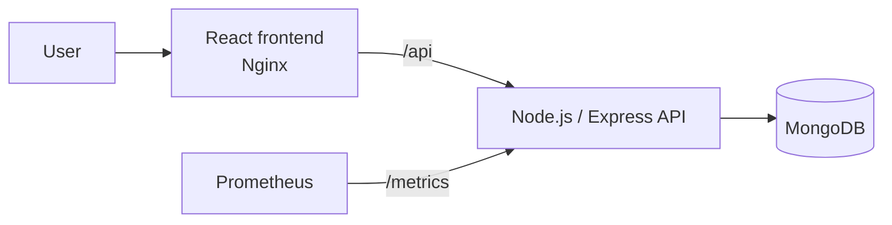
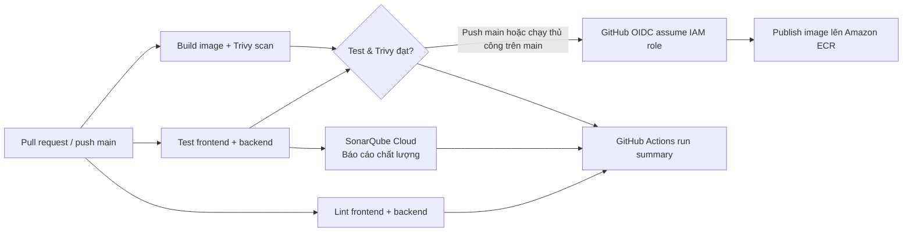
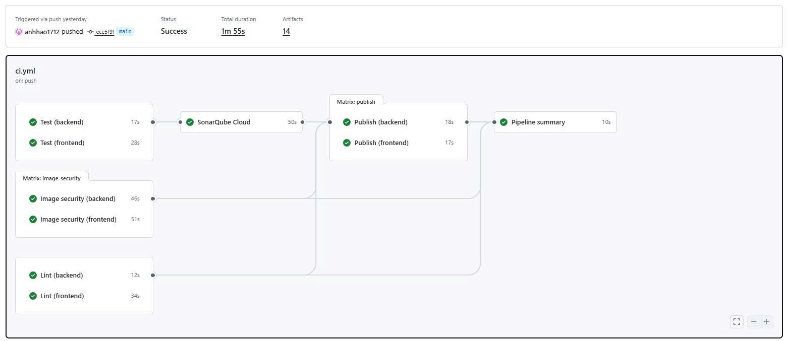
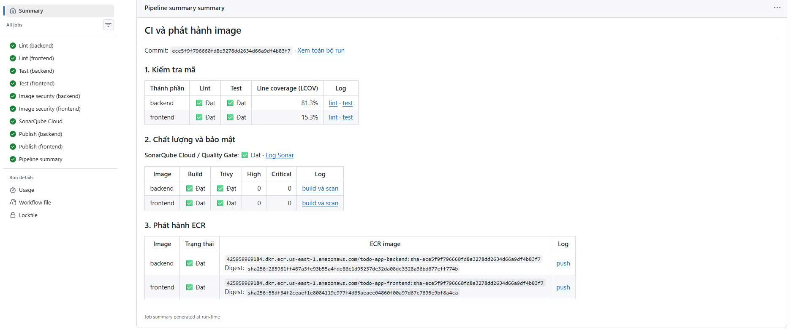

# Todo App — CI/CD and Kubernetes

Ứng dụng Todo mẫu dùng để thực hành kiến trúc microservice cơ bản, pipeline CI/CD và triển khai container lên Kubernetes. Trọng tâm của repository là kiểm tra chất lượng mã, quét bảo mật image và phát hành image lên Amazon ECR.

## Kiến trúc



- **Frontend:** React, được build thành static files và phục vụ bằng Nginx (`/healthz`, truyền `X-Request-Id` và W3C `traceparent`).
- **Backend:** Node.js và Express, cung cấp Todo API, `/healthz`, `/readyz`, `/metrics`, log JSON cấu trúc và OpenTelemetry tracing (chi tiết hợp đồng telemetry xem tại [`docs/observability-telemetry.md`](docs/observability-telemetry.md)).
- **Database:** MongoDB.
- **Container:** Docker multi-stage build; backend chạy bằng user không phải root.
- **Local composition:** Docker Compose mô tả frontend, backend và MongoDB.

## GitHub Actions pipeline

Workflow nằm tại [`.github/workflows/ci.yml`](.github/workflows/ci.yml). Pull request và push lên `main` chạy các kiểm tra. Các job lint, test và quét image cho frontend/backend chạy song song; job SonarQube nhận coverage từ hai job test để báo cáo chất lượng mã (soft gate, không chặn phát hành image).



Pipeline thực hiện:

1. Chạy lint và test cho backend/frontend song song.
2. Build image theo từng thành phần và chặn phát hành nếu Trivy tìm thấy lỗ hổng High/Critical.
3. Gửi coverage lên SonarQube Cloud để theo dõi chất lượng mã và ghi kết quả vào Summary (`continue-on-error: true`, không làm nghẽn bước publish; khi cần siết chặt Quality Gate on New Code cho PR có thể bật điều kiện ở workflow).
4. Chỉ khi Test và Trivy đạt trên nhánh `main`, job `publish` mới dùng OIDC để nhận quyền AWS tạm thời và đẩy image lên ECR.
5. Gắn image với commit SHA, kiểm tra digest sau khi push và ghi kết quả vào GitHub Actions summary.

Pull request không đẩy image lên ECR. Workflow hiện phát hành image lên ECR; việc triển khai lên EKS/đồng bộ Argo CD là bước riêng của phần manifests/GitOps.

### Ảnh minh họa kết quả pipeline

Các ảnh dưới đây là minh họa từ một lần chạy thành công; thời gian và kết quả ở lần chạy khác có thể thay đổi.

**Thời lượng và sơ đồ các job:**



**Bảng tổng kết CI, scan và phát hành ECR:**



## Cấu hình GitHub và AWS

Job phát hành cần các cấu hình sau trong **Repository → Settings → Secrets and variables → Actions**:

| Tên | Loại | Mục đích |
| --- | --- | --- |
| `AWS_ROLE_ARN` | Variable | ARN của IAM role cho GitHub OIDC |
| `AWS_REGION` | Variable, tùy chọn | AWS region; mặc định `ap-southeast-1` |
| `ECR_ENV` | Variable, tùy chọn | Hậu tố môi trường tên ECR repo; mặc định `dev` |
| `SONAR_ORGANIZATION` | Variable | SonarQube Cloud organization key |
| `SONAR_PROJECT_KEY` | Variable | SonarQube Cloud project key |
| `SONAR_TOKEN` | Secret | Token dùng để phân tích trên SonarQube Cloud |

IAM role nên giới hạn trust vào repository `phuocan803/todo-app-src` và nhánh `main`, đồng thời chỉ cấp quyền cần thiết cho hai ECR repositories `todo-app-backend-dev` và `todo-app-frontend-dev` (theo cấu hình `todo-app-<component>-${ECR_ENV}` trong `todo-app-infra`). Hướng dẫn role và policy nằm trong [`.github/aws/oidc-role.md`](.github/aws/oidc-role.md).

## Cấu trúc thư mục

```text
.
├── .github/
│   ├── aws/                 # Hướng dẫn IAM/OIDC
│   ├── scripts/             # Báo cáo, Sonar, publish image, summary
│   └── workflows/ci.yml     # Pipeline CI và phát hành image
├── backend/                 # Express API, MongoDB model và tests
├── frontend/                # React app và Nginx config
├── docs/                    # Tài liệu và ảnh minh họa pipeline
└── docker-compose.yaml      # Chạy các service local
```

## Xem kết quả một lần chạy

Trong tab **Actions** của GitHub, mở workflow run để xem sơ đồ job, log từng bước, artifacts báo cáo Trivy và phần **Pipeline summary**. Image được phát hành theo commit SHA; release record cũng lưu digest ECR để đối chiếu image đã push.
